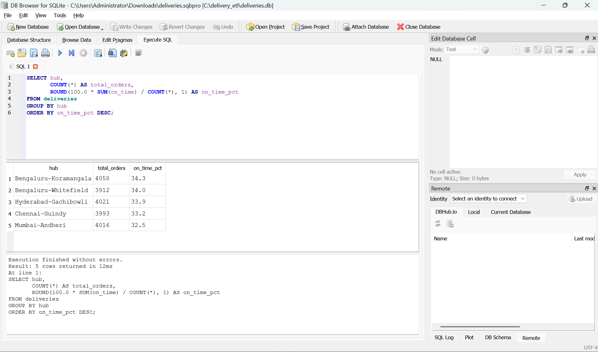

# Delivery ETL Project (Python + SQLite + SQL)

In this project, I took messy delivery data, cleaned it with Python, stored it in a database, and answered business questions using SQL.

**Note:** The data is fake. I generated it with a Python script, so it is not from any real company.

## What I did

1. **Created the data:** I wrote a script that makes 20,000 delivery orders. I added problems on purpose, like duplicate rows, missing rider IDs, hub names in mixed upper and lower case, and dates in two different formats.
2. **Cleaned the data:** I used pandas to remove duplicates, fix the hub names, fill the missing rider IDs, and make all the dates the same format. I also added a column that shows if a delivery was on time.
3. **Stored the data:** I loaded the clean data into a SQLite database.
4. **Answered questions with SQL:** I wrote 6 queries to find useful answers from the data.

## Questions I answered with SQL

- Which hub delivers on time the most?
- Which riders have the best on-time record?
- What are the busiest pickup hours?
- Why do deliveries fail?
- How do hubs rank inside each city?
- How does on-time delivery change week by week?

## Result: on-time % by hub



## What I learned

- Real data is often messy, so cleaning it is an important first step.
- How to handle duplicates, missing values, and mixed date formats in pandas.
- How to use GROUP BY, HAVING, and window functions in SQL.

## How to run it

```
pip install pandas
python 1_generate_data.py
python 2_clean_and_load.py
```

Then open `deliveries.db` in DB Browser for SQLite and run the queries from `3_queries.sql`.

## Tools used

Python, pandas, SQLite, SQL, DB Browser for SQLite
